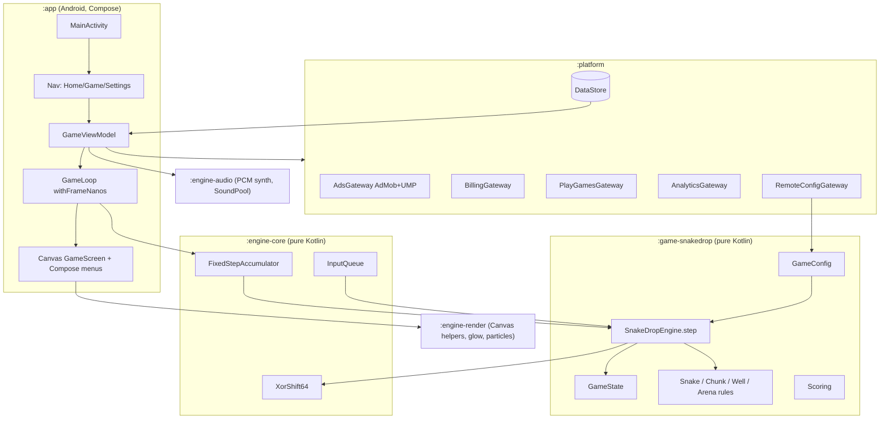

# System Topology Diagram


# Component Interactions
- **Input path:** Compose `pointerInput` detects swipe → `InputQueue.push(Dir)` → consumed by `step()` at next snake tick.
- **Loop path:** `GameLoop` reads frame time via `withFrameNanos` → clamps dt (≤ 250 ms) → `FixedStepAccumulator` runs N fixed steps at 120 Hz → publishes latest `GameState` snapshot to the renderer.
- **Snake cadence:** `SnakeDropEngine` converts accumulated sim ticks to snake moves using `ticksPerMove = SIM_HZ / snakeSpeed`. Chunk fall uses its own timer (`chunkFallMs`). Both live in `GameState` as integer tick counters.
- **Events out:** `step()` returns `StepResult(state, events)`. Events are value objects: `AppleEaten`, `ChunkDetached`, `ChunkLanded`, `RowsCleared(n)`, `ArenaWarning`, `ArenaShrunk`, `RunEnded(cause)`. `GameViewModel` maps events to audio, haptics, particles, analytics.
- **Render path:** `GameScreen` Canvas reads `GameState` + particle pool → draws arena, well, snake, chunk, HUD. Render never mutates state.
- **Audio path:** `:engine-audio` synthesizes PCM at first launch → caches → `SoundPool` plays by `SfxId`. ViewModel triggers on events only.
- **Persistence:** `GameViewModel` writes best score/settings to DataStore through `SettingsRepository`. Reads happen once at startup.
- **Ads/Billing:** `AdPolicy` (pure, in `:game-snakedrop`) decides *whether*; `AdsGateway` (in `:platform`) decides *how*. Never put ad decisions in UI code.
- **Remote tuning:** `RemoteConfigGateway.fetch()` at startup (non-blocking) → validated + clamped → `GameConfig.override()` applied only at the start of a new run. Never mid-run.
- **Analytics:** Emit run-level summaries only (`run_end`), not per-apple events.

# Folder Structure & File Responsibilities
```
snake-drop/
├─ settings.gradle.kts            # module list
├─ build.gradle.kts               # root plugins only
├─ gradle/libs.versions.toml      # single dependency source of truth
├─ app/                           # Android app module
│  └─ src/main/
│     ├─ AndroidManifest.xml      # permissions: INTERNET, ACCESS_NETWORK_STATE, AD_ID only
│     ├─ java/.../MainActivity.kt # single Activity, edge-to-edge
│     ├─ java/.../nav/            # NavHost, routes Home/Game/Settings
│     ├─ java/.../game/           # GameViewModel, GameLoop, GameScreen (Canvas)
│     ├─ java/.../home/           # HomeScreen
│     ├─ java/.../settings/       # SettingsScreen, SettingsRepository (DataStore)
│     ├─ java/.../theme/          # Color.kt, Type.kt, Dimens.kt (tokens from Design.md)
│     └─ res/                     # vector icon, strings.xml, one OFL font + LICENSE
├─ engine-core/                   # pure Kotlin/JVM
│  └─ src/main/kotlin/            # FixedStepAccumulator, XorShift64, InputQueue, RingBuffer
├─ engine-render/                 # Android library
│  └─ src/main/kotlin/            # GlowStroke, ParticlePool, NeonPalette, DrawUtils
├─ engine-audio/                  # Android library
│  └─ src/main/kotlin/            # Synth (square/triangle/noise + ADSR), SfxBank, MusicLoop
├─ game-snakedrop/                # pure Kotlin/JVM
│  └─ src/main/kotlin/
│     ├─ GameConfig.kt            # all tunables + PRD citations
│     ├─ GameState.kt             # state schema (see schema.md)
│     ├─ SnakeDropEngine.kt       # step() orchestration
│     ├─ SnakeRules.kt            # move, turn validation, collisions
│     ├─ ChunkRules.kt            # detach, spawn, fall, lock
│     ├─ WellRules.kt             # row detection, clear, gravity, height
│     ├─ ArenaRules.kt            # shrink thresholds, warning, crush check
│     ├─ Scoring.kt               # apple/chunk/row-clear formulas
│     ├─ Events.kt                # StepResult + event types
│     └─ AdPolicy.kt              # interstitial/revive gating (pure)
├─ platform/                      # Android library (SDK wrappers)
│  └─ src/main/kotlin/            # AdsGateway, BillingGateway, PlayGamesGateway,
│                                 # AnalyticsGateway, RemoteConfigGateway, ConsentManager
├─ tools/                         # JVM utilities (optional)
│  └─ src/main/kotlin/            # SimulationFuzzer (10,000 random runs)
└─ docs/                          # these .md files
```
- **`:app`:** Wire everything. Own UI, navigation, lifecycle. Contain zero game rules.
- **`:game-snakedrop`:** Own all rules and the state schema. Remain unit-testable on JVM.
- **`:engine-core`:** Own loop primitives and RNG. Stay game-agnostic.
- **`:engine-render`:** Own drawing helpers. Never hold game state.
- **`:engine-audio`:** Own synthesis and playback. Expose `SfxId` enum only.
- **`:platform`:** Isolate every third-party SDK. Expose interfaces so `:app` and tests use fakes.
- **`tools`:** Never ship in the APK.
